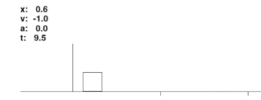
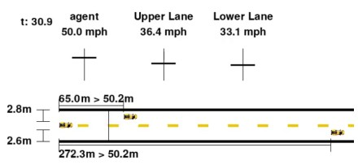

# safe-barrier-envs

Provides the car environment for the paper
"Barrier Function Overrides For Non-Convex Fixed-Wing Flight
Control and Self-Driving Cars."

## Installation

```bash
conda create -y -n safe-barrier-envs python=3.13
conda activate safe-barrier-envs

# if using pytorch, see https://pytorch.org/get-started/locally/
pip install -e .
```

## Run Environments

There are two environments provided: double integrator and car.
The files in the `scripts` directory provide a minimal implementation for how to
use a controller within each environment. For more involved examples see
the `tests` directory. Each script in the `tests` directory can be run
without arguments from the command line or with `pytest`.

### Double Integrator Environment

The double integrator is a simple test case that runs quickly and is easy to
debug. The agent controls acceleration and receives a reward every time it
further to the left on the x-axis so it is incentived to choose maximum
negative acceleration. At the same time there is a constraint that it must not
hit a wall located at the origin.

The environment also includes a controller to achieve a given
velocity. For instance, if we want the agent to achieve a speed
of -1 meter per second, we can use the following:

```bash
cd scripts
python run_dbl_int.py --tgt_speed -1
```



### Car Environment

The car environment consists of a a self-driving car
doing adaptive cruise control with lane merging. In front
of the self-driving car is a lead car in each lane.
The lead car chooses a random speed at random times
while the self-driving car must avoid collisions while
attempting to achieve the target velocity. It must change
lanes to reach this target velocity because the two lead
cars will likely travel at different speeds. The self-driving
car controls acceleration and the steering wheel angle.
An example of controlling it to run at 50 miles per hour is
can be run as follows:

```bash
cd scripts
python run_car.py --tgt_speed 50
```



## Style Guide

See pyproject.toml and .flake8 for the style guide. The code should pass these checks

```bash
isort scripts safe_barrier_envs
black scripts/*.py safe_barrier_envs/*.py
flake8 scripts safe_barrier_envs
mypy scripts safe_barrier_envs
pylint scripts safe_barrier_envs
```
